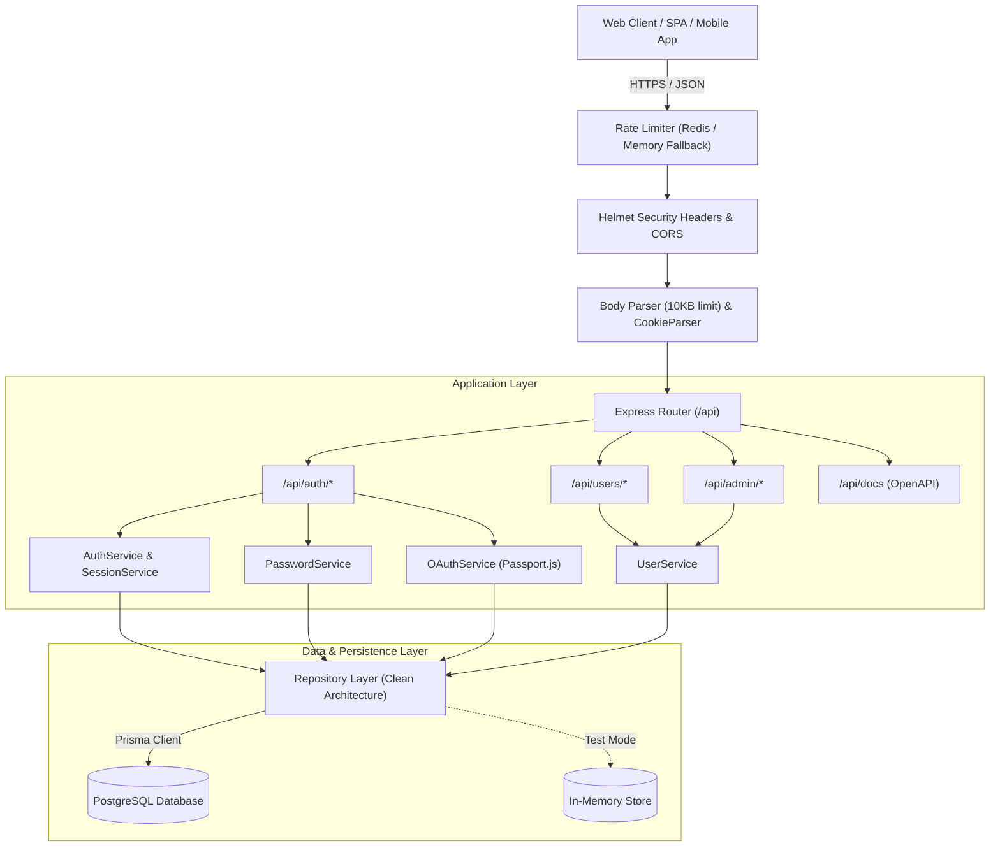
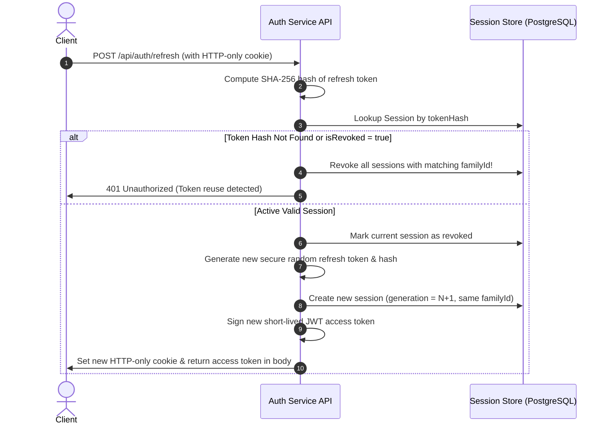

# Production-Ready Authentication & Authorization Service (`auth-service`)

[](https://github.com/Adarsh-mk7/auth-service/actions)
[](https://opensource.org/licenses/MIT)
[](https://nodejs.org/)
[](https://www.typescriptlang.org/)

A production-grade, modular microservice providing end-to-end authentication, session management, Role-Based Access Control (RBAC), and Google OAuth 2.0 integration. Engineered with TypeScript, Express.js, PostgreSQL (Prisma ORM), Redis, and Passport.js.

---

## Table of Contents

- [Key Features](#key-features)
- [Architecture & Request Flows](#architecture--request-flows)
  - [System Architecture](#system-architecture)
  - [Token Refresh & Rotation Flow](#token-refresh--rotation-flow)
- [Technology Stack](#technology-stack)
- [RBAC Permission Matrix](#rbac-permission-matrix)
- [API Endpoints Reference](#api-endpoints-reference)
- [Getting Started](#getting-started)
  - [Prerequisites](#prerequisites)
  - [Installation](#installation)
  - [Environment Variables](#environment-variables)
  - [Database Setup & Migrations](#database-setup--migrations)
  - [Running with Docker Compose](#running-with-docker-compose)
- [Automated Testing](#automated-testing)
- [Security Architecture & Best Practices](#security-architecture--best-practices)
  - [Security Decisions](#security-decisions)
  - [Known Limitations & Production Hardening](#known-limitations--production-hardening)
- [Google OAuth 2.0 Setup](#google-oauth-20-setup)
- [Email Provider Configuration](#email-provider-configuration)
- [Troubleshooting](#troubleshooting)
- [Contributing](#contributing)
- [License](#license)

---

## Key Features

- **Robust User Registration**: Validates and normalizes email addresses, enforces strong password policies, and securely hashes passwords with `bcrypt` using an adaptive work factor.
- **Short-Lived Access Tokens**: Cryptographically signed JSON Web Tokens (JWT) with strict issuer, audience, and unique `jti` claim validation.
- **Secure Refresh Token Rotation**: Implements RFC 6749 and Auth0-standard refresh token rotation with token family tracking, SHA-256 token hashing, and rapid concurrent request grace periods.
- **Refresh Token Reuse Detection**: Instantly detects and halts token replay attacks by invalidating the entire compromised token family.
- **HTTP-Only, SameSite Cookies**: Delivers refresh tokens exclusively through secure HTTP-only cookies, shielding them against Cross-Site Scripting (XSS).
- **Session Management**: Tracks active user devices, IP addresses, user agents, creation timestamps, and provides both single-session logout and `logout-all` session termination.
- **Role-Based Access Control (RBAC)**: Fine-grained access control across `USER`, `MODERATOR`, and `ADMIN` roles with ownership enforcement middleware to prevent horizontal and vertical privilege escalation.
- **Enumeration-Safe Password Reset**: Secure single-use password reset tokens with SHA-256 storage, short expirations, generic HTTP responses, and automatic session invalidation upon reset.
- **Google OAuth 2.0 with Passport.js**: Secure social login with CSRF state verification, verified-email account linking policies, and fallback local development modes.
- **Distributed Rate Limiting**: Redis-backed rate limiting with seamless in-memory fallback for brute-force mitigation on authentication endpoints.
- **Hardened HTTP Headers & CORS**: Strict Helmet security headers, environment-driven CORS allowlists, and 10kb request payload caps against denial-of-service.
- **Interactive OpenAPI 3.0 Documentation**: Complete interactive Swagger UI available at `/api/docs`.

---

## Architecture & Request Flows

### System Architecture



### Token Refresh & Rotation Flow



---

## Technology Stack

| Layer | Technology | Purpose |
|---|---|---|
| **Runtime** | Node.js (v22+) | High-performance asynchronous JavaScript engine |
| **Language** | TypeScript (v5.7+) | Static typing, interface definitions, and developer ergonomics |
| **Framework** | Express.js (v4.21+) | Minimalist, battle-tested HTTP server and routing |
| **ORM** | Prisma (v5.22+) | Type-safe database client and SQL migrations |
| **Database** | PostgreSQL (v16+) | ACID-compliant relational data store |
| **Cache / Rate Limit** | Redis (v7+) / In-Memory | Distributed sliding window rate limiting |
| **Hashing** | `bcryptjs` / `crypto` | Adaptive password hashing & SHA-256 token digests |
| **Token Format** | `jsonwebtoken` | RFC 7519 JSON Web Tokens for short-lived access credentials |
| **Social Login** | Passport.js (`passport-google-oauth20`) | Google OAuth 2.0 authentication strategy |
| **Validation** | Zod (v3.24+) | Schema validation, type inference, and input sanitization |
| **Documentation** | OpenAPI 3.0 / Swagger UI | Interactive API specification and testing console |
| **Test Framework** | Vitest & Supertest | Sub-second unit and integration test runner |

---

## RBAC Permission Matrix

| Capability | Role: `USER` | Role: `MODERATOR` | Role: `ADMIN` |
|---|:---:|:---:|:---:|
| Register / Login / Logout | ✅ | ✅ | ✅ |
| Rotate Refresh Tokens | ✅ | ✅ | ✅ |
| Access Own Profile (`/api/auth/me`) | ✅ | ✅ | ✅ |
| View Own Sessions (`/api/auth/sessions`) | ✅ | ✅ | ✅ |
| Change Own Password (`/api/auth/change-password`) | ✅ | ✅ | ✅ |
| Public Users Directory (`/api/users`) | Basic (ID, Name) | Full Profile | Full Profile |
| Access Specific User (`/api/users/:id`) | Own resource only | ✅ | ✅ |
| List Administrative Users (`/api/admin/users`) | ❌ | ❌ | ✅ |
| Change User Roles (`/api/admin/users/:id/role`) | ❌ | ❌ | ✅ |
| Prevent Demoting Sole Admin | N/A | N/A | Enforced |

---

## API Endpoints Reference

All API routes are prefixed with `/api`. Interactive documentation is available at `/api/docs`.

### Authentication & Sessions (`/api/auth`)

| Method | Endpoint | Description | Auth Required |
|---|---|---|---|
| `POST` | `/api/auth/register` | Register new account with name, email, and password | Public |
| `POST` | `/api/auth/login` | Authenticate with email/password; receives access token & cookie | Public |
| `POST` | `/api/auth/refresh` | Rotate refresh token cookie and obtain fresh access token | Cookie |
| `POST` | `/api/auth/logout` | Revoke current refresh token and clear cookie | Public / Cookie |
| `POST` | `/api/auth/logout-all` | Revoke all active sessions across all devices | Bearer JWT |
| `GET` | `/api/auth/me` | Retrieve authenticated user's profile | Bearer JWT |
| `GET` | `/api/auth/sessions` | List active sessions with device/IP metadata | Bearer JWT |
| `POST` | `/api/auth/forgot-password` | Request password reset email (enumeration-safe) | Public |
| `POST` | `/api/auth/reset-password` | Reset password using single-use reset token | Public |
| `POST` | `/api/auth/change-password` | Change password with current password verification | Bearer JWT |
| `GET` | `/api/auth/google` | Initiate Google OAuth 2.0 flow with CSRF state | Public |
| `GET` | `/api/auth/google/callback` | Google OAuth provider callback handler | Public |

### User Management & Administration (`/api/users` & `/api/admin`)

| Method | Endpoint | Description | Auth Required |
|---|---|---|---|
| `GET` | `/api/users` | List users (basic info for USER, full info for MOD/ADMIN) | Bearer JWT |
| `GET` | `/api/users/:id` | Get user by ID (enforces ownership or ADMIN/MOD role) | Bearer JWT |
| `GET` | `/api/admin/users` | List all users with administrative audit data | ADMIN Role |
| `PATCH` | `/api/admin/users/:id/role` | Update user role (`USER`, `MODERATOR`, `ADMIN`) | ADMIN Role |

---

## Getting Started

### Prerequisites

- **Node.js**: v20 or v22 LTS ([Download](https://nodejs.org/))
- **npm**: v10+
- **Docker & Docker Compose** (Optional, for running PostgreSQL and Redis containers)

### Installation

1. Clone repository:
   ```bash
   git clone https://github.com/Adarsh-mk7/auth-service.git
   cd auth-service
   ```

2. Install dependencies:
   ```bash
   npm ci
   ```

3. Set up environment configuration:
   ```bash
   cp .env.example .env
   ```

### Environment Variables

| Variable | Default Value | Description |
|---|---|---|
| `PORT` | `4000` | Port for Express server |
| `NODE_ENV` | `development` | Runtime environment (`development`, `production`, `test`) |
| `DATABASE_URL` | `postgresql://...` | PostgreSQL connection string |
| `REDIS_URL` | `redis://localhost:6379` | Redis connection URL |
| `REDIS_ENABLED` | `false` | Enable distributed Redis rate limiter (falls back to memory if false) |
| `JWT_ACCESS_SECRET` | *(Random 32+ chars)* | Secret used to sign access JWTs |
| `JWT_ACCESS_EXPIRY` | `15m` | Lifetime of access tokens |
| `JWT_REFRESH_EXPIRY_DAYS` | `7` | Lifetime of refresh token sessions |
| `COOKIE_SECRET` | *(Random 32+ chars)* | Secret for cookie parsing |
| `COOKIE_SAME_SITE` | `lax` | SameSite cookie attribute (`lax`, `strict`, `none`) |
| `GOOGLE_CLIENT_ID` | `""` | Google OAuth 2.0 Web Client ID |
| `GOOGLE_CLIENT_SECRET` | `""` | Google OAuth 2.0 Client Secret |
| `GOOGLE_CALLBACK_URL` | `http://localhost:4000/api/auth/google/callback` | OAuth redirect URI |

### Database Setup & Migrations

When running with a local PostgreSQL instance or Docker:

```bash
# Generate Prisma Client
npm run prisma:generate

# Run PostgreSQL Migrations
npm run prisma:migrate

# (Optional) Seed development users
npm run seed
```

### Running with Docker Compose

To spin up the entire production-like environment with PostgreSQL, Redis, and `auth-service`:

```bash
docker-compose up --build
```

Access:
- **API**: `http://localhost:4000`
- **Swagger Documentation**: `http://localhost:4000/api/docs`
- **Health Check**: `http://localhost:4000/health`

---

## Automated Testing

The service includes an exhaustive automated test suite using **Vitest** and **Supertest**. Tests run completely offline and in-memory without requiring live database connections or third-party OAuth/email servers.

```bash
# Run all unit and integration tests
npm test

# Run tests in watch mode
npm run test:watch

# TypeScript type check
npm run typecheck

# Production build
npm run build
```

### Test Suite Coverage Overview

- `tests/unit/health.test.ts`: Health check endpoint verification.
- `tests/unit/password.test.ts`: Bcrypt work factors, salt randomness, and comparison timing safety.
- `tests/unit/token.test.ts`: JWT signing, decoding, expiration validation, and SHA-256 hashing.
- `tests/unit/repositories.test.ts`: Data access layer and session family revocation.
- `tests/integration/register.test.ts`: Registration validation, email normalization, password policy enforcement, and duplicate rejection.
- `tests/integration/auth_tokens.test.ts`: Login, JWT issuance, HTTP-only cookie delivery, token rotation, and reuse detection.
- `tests/integration/session_management.test.ts`: Device tracking, single-session logout, and `logout-all` session invalidation.
- `tests/integration/rbac_authorization.test.ts`: RBAC permission barriers (`USER`, `MODERATOR`, `ADMIN`), sole admin lockout protection, and resource ownership checks.
- `tests/integration/password_management.test.ts`: Account enumeration-safe forgot-password, single-use token replay rejection, and session invalidation.
- `tests/integration/google_oauth.test.ts`: Google OAuth sign-in, CSRF state verification, verified-email account linking, and unverified-email takeover rejection.
- `tests/integration/security_rate_limits.test.ts`: Distributed rate limiting, Helmet security headers, CORS allowlist, and 10KB payload restrictions.
- `tests/integration/e2e_lifecycle.test.ts`: Full end-to-end user lifecycle test from registration to teardown.

---

## Security Architecture & Best Practices

### Security Decisions

1. **Hashed Refresh & Reset Tokens**: Plaintext tokens are never stored in the database. Only SHA-256 hashes are persisted, ensuring that even in the event of a database snapshot leak, active session tokens cannot be minted.
2. **Token Family Rotation**: Every token refresh increments a generation counter within an immutable family. If an older token is presented, the entire family is revoked, neutralizing replay attacks.
3. **No Account Enumeration**: Authentication and forgot-password endpoints return identical responses regardless of whether an email address exists in the system.
4. **Safe OAuth Account Linking**: Accounts are automatically linked only if the email is confirmed verified by Google. If a local user exists with an unverified email, auto-linking is rejected to protect against account takeover.
5. **No Client-Supplied Roles**: Role assignments are ignored during user registration. Role promotions can only be executed by administrators through `/api/admin/users/:id/role`.

### Known Limitations & Production Hardening

- **Redis Clustering**: In massive distributed topologies, Redis Sentinel or Redis Cluster should be enabled for high-availability rate limiting.
- **TLS Termination**: Production deployments must run behind a reverse proxy (e.g., NGINX, Cloudflare, or AWS ALB) enforcing HTTPS and HTTP Strict Transport Security (`HSTS`).
- **Secret Management**: Never commit `.env` files. Secrets should be injected via cloud key management services (AWS Secrets Manager, HashiCorp Vault, or GitHub Secrets).

---

## Google OAuth 2.0 Setup

1. Navigate to the [Google Cloud Console](https://console.cloud.google.com/).
2. Create a new project and go to **APIs & Services > Credentials**.
3. Create an **OAuth 2.0 Client ID** with Application Type: **Web Application**.
4. Add Authorized Redirect URI: `http://localhost:4000/api/auth/google/callback`.
5. Copy your **Client ID** and **Client Secret** into your `.env` file:
   ```env
   GOOGLE_CLIENT_ID=your_google_client_id.apps.googleusercontent.com
   GOOGLE_CLIENT_SECRET=your_google_client_secret
   ```

---

## Email Provider Configuration

By default, `EMAIL_PROVIDER=mock` captures sent emails in memory for fast local testing and debugging. For production:

```env
EMAIL_PROVIDER=smtp
SMTP_HOST=smtp.mailgun.org
SMTP_PORT=587
SMTP_USER=postmaster@yourdomain.com
SMTP_PASS=your_smtp_password
EMAIL_FROM=no-reply@yourdomain.com
FRONTEND_URL=https://app.yourdomain.com
```

---

## Troubleshooting

- **CORS Errors**: Verify that `CORS_ORIGIN` in `.env` includes your frontend URL without a trailing slash (e.g., `http://localhost:3000`).
- **Cookies Not Stored in Browser**: Ensure your frontend client is configured with `credentials: 'include'` (Fetch) or `withCredentials: true` (Axios).
- **Prisma Schema Generation**: Run `npm run prisma:generate` if TypeScript models are out of sync with `schema.prisma`.

---

## Contributing

1. Fork the repository.
2. Create your feature branch (`git checkout -b feature/amazing-feature`).
3. Commit your changes with Conventional Commits (`git commit -m 'feat: add amazing feature'`).
4. Ensure all tests and type checks pass (`npm test && npm run typecheck`).
5. Push to the branch (`git push origin feature/amazing-feature`).
6. Open a Pull Request.

---

## License

Distributed under the MIT License. See [LICENSE](LICENSE) for more information.
